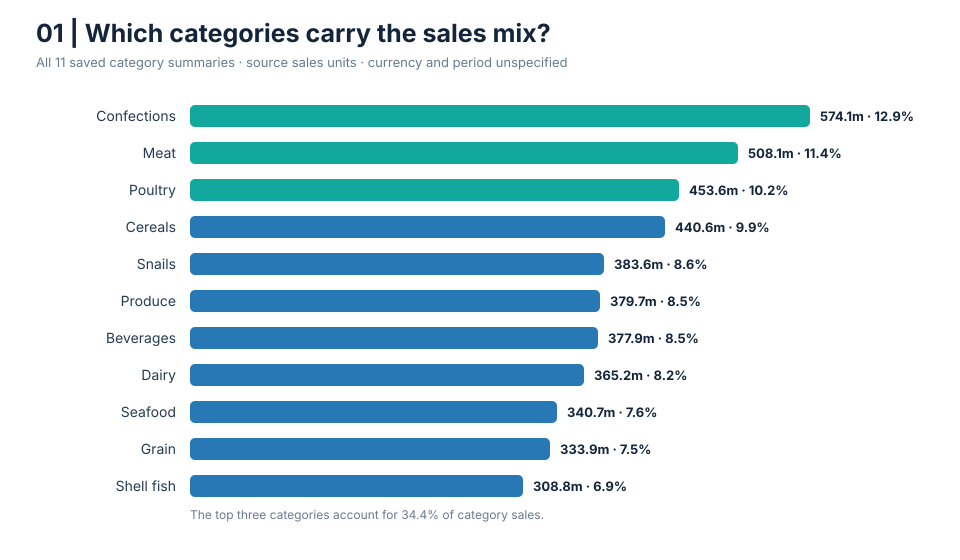

# E-commerce Revenue Mix & Data Quality Diagnostic

**Portfolio case study | Excel Data Model + Python + SQL | October 2026**

## Executive summary

This project answers a practical merchandising question: **Which product categories and cities account for the most reported sales, and is the data reliable enough to guide investment?**

The workbook contains a seven-query sales model and saved PivotTable summaries. Those summaries show 4.47 billion reported sales units across 11 categories. The top three categories contribute 34.4% of the total. The displayed top ten cities are tightly grouped, from 48.09 million to 49.99 million units. A separate customer summary has 11.42 million units assigned to a blank customer bucket.

The recommended decision is to use these results to prioritize validation and follow-up analysis, not to reallocate budget yet. The workbook does not establish currency, reporting period, profit, order counts, or the complete city population. Revenue alone cannot show whether a category or city is profitable.

## What I built

- A compact, reproducible Python analysis using only the Python standard library.
- SQL queries for category mix, top-city spread, and unassigned customer sales.
- Cleaned aggregate CSV extracts with customer names and raw transaction records excluded.
- Generated summary metrics and two SVG charts for a GitHub README or portfolio site.
- A decision brief with actions, caveats, and the next data needed to approve a commercial test.

## Findings

1. **Category mix:** The three largest categories are Confections, Meat, and Poultry. Together they contribute 34.4% of reported sales. This is a descriptive mix finding, not evidence that these categories have the best margin or growth.
2. **Top-city spread:** Among the ten cities shown in the workbook’s Top 10 PivotTable, sales span 48.09–49.99 million units. This is a narrow spread within that selected group; it says nothing about all other cities or market potential.
3. **Customer attribution:** The saved customer summary assigns 11.42 million units to a blank customer bucket, about 0.26% of total category sales. Resolve the customer key before using customer-level retention or lifetime-value analysis.
4. **Relationship validation:** Examples in a saved category/product summary appear inconsistent (for example, a seafood-style product under Cereals). Treat these as validation flags only: the underlying model rows and relationships were not queryable in this analysis, so the examples are not confirmed errors.

### Category sales mix



### Displayed Top 10 cities


## Recommended actions

### Do now

- Reconcile the category sales total to the model measure and document its definition, currency, and reporting dates.
- Trace the blank customer bucket back to source keys; quantify affected orders and sales after refreshing the model.
- Validate product-to-category mappings against the Products table and test referential integrity before publishing product-level conclusions.
- Add a visible “Top 10 cities only” label to any city chart or dashboard.

### Do next, before changing spend

- Join orders, order lines, products, customers, and geography at transaction grain.
- Calculate gross sales, discounts, refunds/returns, net sales, cost, and contribution margin consistently.
- Compare category and city performance by month, order count, average order value, repeat rate, and stock availability.
- Test one category or city intervention with a holdout/control group; judge it on incremental contribution margin, not revenue alone.

## Reproduce the analysis

Requirements: Python 3.10 or later. No third-party packages are needed.

```bash
python analyze.py
```

The command rewrites analysis/summary.json and the two SVG figures from category files.


The SQL file uses SQLite syntax. From the repository root, load the CSVs and run the queries:

```bash
sqlite3 ecommerce.db < sql/analysis.sql
```

The SQL script creates its tables and uses relative CSV paths through SQLite's `.import` shell command. If your SQLite build does not support `.import`, load the two CSV files with your preferred database client, then run the queries below the import section.

## Repository map

```text
data/                 Aggregate category and Top 10 city CSVs
sql/analysis.sql      SQLite schema, load instructions, and analysis queries
analysis/             Generated JSON summary and SVG charts
analyze.py            Reproducible standard-library analysis
DECISION_BRIEF.md     Business readout
DATA_DICTIONARY.md    Fields, definitions, and source limitations
```

## Data and privacy note

The CSVs contain only aggregate category and Top 10 city summaries from the user's workbook; no customer names, transaction rows, or employee names are included. The source workbook itself is not included. The user approved publishing these aggregate figures. The figures are in source sales units, not a named currency, and have no verified reporting period.

The source workbook's saved PivotTable values were inspected locally. Its embedded Data Model was not queryable in this analysis environment, so this is an aggregate-level case study rather than a full transaction-level audit.

## Portfolio positioning

**Role fit:** Data Analyst (primary), with relevant merchandising and operations decision support.

**Skills shown:** KPI definition discipline, category mix analysis, geographic ranking, data-quality triage, SQL aggregation, Python reproducibility, and evidence-based decision framing.

**Interview summary:** “I audited an existing multi-table sales model using its saved summaries. I measured category mix and the spread among its top ten cities, surfaced a blank customer attribution bucket and a product/category mapping concern, and recommended the checks and profitability metrics needed before changing merchandising or local-market investment.”

See `DECISION_BRIEF.md` for the full readout and `DATA_DICTIONARY.md` for metric definitions.
