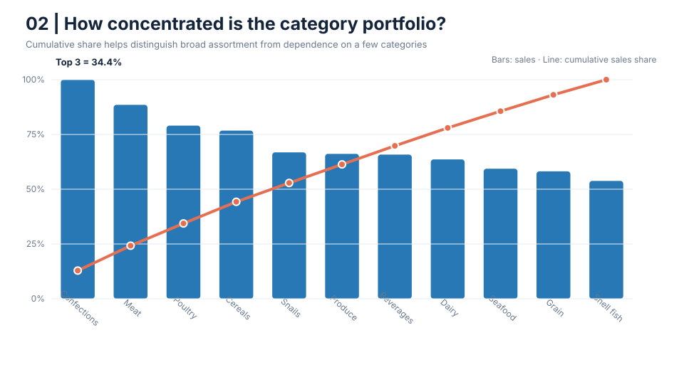
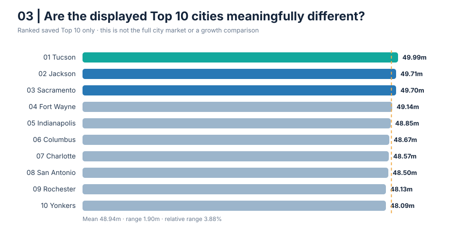
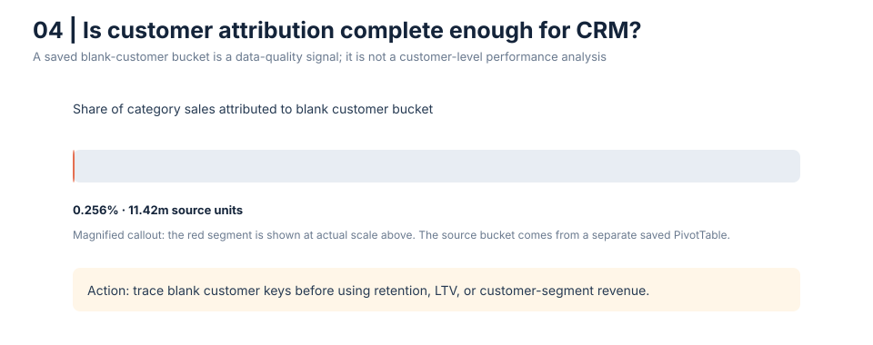

# E-commerce Merchandising & Market Diagnostic

**Portfolio case study · Excel Data Model summaries · Python · SQL**

## Business context

A retail/e-commerce team needs to decide where to focus merchandising and local-market analysis. The source workbook contains sales summaries by product category and a saved Top 10 city view, plus a separate customer summary. I turned those existing summaries into four business questions, quantified the answers, and made the decision limits visible.

> **Read this as sales mix, not verified revenue.** The workbook does not identify currency or reporting period. Its embedded Data Model rows were not queryable here, so calculations use saved PivotTable summaries. No profitability, growth, customer lifetime value, or causal uplift claim is made.

## Four business questions and answers

### 1. Is category sales concentrated in a small part of the assortment?

**Answer:** Confections, Meat, and Poultry together make up **34.39%** of the 11-category sales total (4.466 billion source units). That is a meaningful shortlist for margin, availability, and repeat-purchase analysis; it does not prove these are the most profitable categories.




### 2. How large is the gap between the category leader and the smallest category?

**Answer:** Confections shows **574.1 million** units, while Shell fish shows **308.8 million**. The leader is **1.86×** the smallest, a **265.3 million** unit difference. Treat this as an assortment-review signal; check margin, stock-outs, promotions, and product breadth before changing placement or spend.

The ranking chart above answers the gap question directly; values and shares are shown beside each bar.

### 3. Are the workbook’s displayed Top 10 cities clearly separated?

**Answer:** The displayed cities range from **48.09 million to 49.99 million** units. The full range is only **3.88% of the Top 10 mean**, so the displayed leaders are tightly grouped. This table is already filtered to the Top 10 and cannot rank the full market or indicate growth potential.



### 4. Is customer attribution complete enough for CRM and personalization decisions?

**Answer:** A separate saved customer summary assigns **11.42 million** units to a blank customer bucket, approximately **0.256%** of category sales. Its small top-line share does not make it safe to ignore for retention, lifetime-value, or personalization work. Trace the blank keys and recalculate at order grain before sizing the fix.



## Recommended decision

Use the category ranking to choose where to investigate margin and availability, and fix customer attribution before customer-level targeting. The city results do not support reallocating local-market spend: values are close and only the selected Top 10 are present. Confirm the sales measure, date range, and currency before any commercial decision.

## Reproduce

Python 3.10+; standard library only.

```bash
python analyze.py
```

This rebuilds `analysis/summary.json` and the four business-question SVGs from the two aggregate CSVs in `data/`. The SQL version is in [`sql/analysis.sql`](sql/analysis.sql).

## Repository contents

- `data/category_sales.csv` — saved category aggregate values.
- `data/top10_city_sales.csv` — the workbook’s displayed Top 10 city values.
- `analyze.py` — validation, calculations, JSON summary, and SVG chart generation.
- `analysis/` — four charts and machine-readable summary.
- `DECISION_BRIEF.md` — action-focused findings and source limitations.
- `DATA_DICTIONARY.md` — measure rules and provenance.

## Data handling and limitations

The public repository contains the user-approved category and city aggregates only. It excludes the original workbook, transaction rows, customer names, and employee details. Figures are in unspecified source units. The customer blank-bucket measure is from a separate saved summary; its denominator is approximate and should be recomputed at a consistent grain. The source examples suggesting product/category mismatches are unconfirmed validation flags.

## Portfolio skills shown

Business question framing · category mix and concentration · geographic ranking · data-quality prioritization · Python reproducibility · SQL aggregation · evidence-based decision communication.
